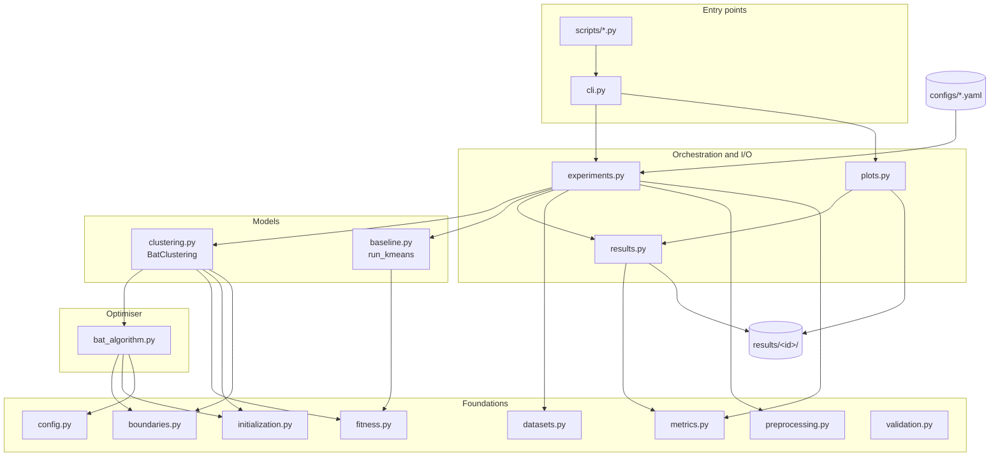
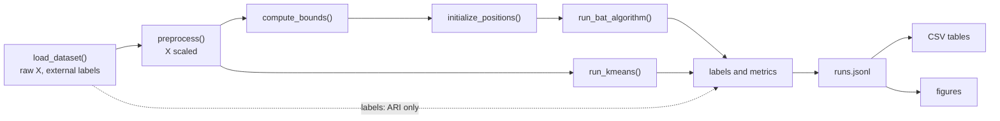

# Architecture

## Overview

A small layered package. Dependencies point one way, from entry points down to pure
mathematics, so the optimiser can be tested with no files, datasets, or plots.



`validation.py` is used by most foundation modules. Those edges are omitted for clarity.

## Module responsibilities

| Module | Responsibility | Must not |
|---|---|---|
| `validation.py` | Exceptions and array validators. | Repair data. |
| `config.py` | `BAConfig`: strict parameter validation. | Hold reference parameter values. |
| `fitness.py` | SSE and squared distances, as pure functions. | Mutate inputs. Move centroids. |
| `boundaries.py` | `Bounds`, computing them, and clipping. | Change velocities. |
| `initialization.py` | Initial positions and pulse rates. | Create a generator of its own. |
| `bat_algorithm.py` | Update equations, iteration, and main loop. | Know about clusters, files, or plots. |
| `clustering.py` | Assignment, and the `BatClustering` estimator. | Accept class labels. |
| `baseline.py` | Multi-start K-Means, with cost counting. | Reuse sklearn's `inertia_` as the reported SSE. |
| `datasets.py` | Loading data; keeping labels separate. | Scale data. Use the network. |
| `preprocessing.py` | Z-score or identity transforms. | Impute missing values. |
| `metrics.py` | Silhouette, ARI, plateau, statistics. | Influence optimisation. |
| `experiments.py` | Spec loading, design expansion, run loop. | Change algorithm behaviour. |
| `results.py` | Manifest, JSONL, tables, overwrite protection. | Contain algorithm logic. |
| `plots.py` | Figures from saved results. | Run an algorithm. |
| `cli.py` | Argument parsing and exit codes. | Contain business logic. |

## Data flow



The dotted edge is the only route for external labels. It reaches evaluation, and it
bypasses optimisation by construction: neither `BatClustering.fit` nor `run_kmeans` has a
parameter for labels.

## Public interfaces

| Interface | Used by | Stability |
|---|---|---|
| `BatClustering`, `BAConfig`, `run_kmeans`, `KMeansConfig` | Library users | Stable; change only with a CHANGELOG entry. |
| Pure update functions, `run_iteration`, `run_bat_algorithm` | Tests, advanced users | Semantics locked by [DECISIONS.md](DECISIONS.md). |
| `ba-clustering` CLI | Researchers | Stable. |
| `configs/*.yaml` schema | Researchers | Strict: unknown keys are errors. |
| `results/<id>/` layout | Analysis, plots | See [RESULTS_GUIDE.md](RESULTS_GUIDE.md). |

Full signatures are in [API_REFERENCE.md](API_REFERENCE.md).

## State ownership

| State | Owner | Lifetime |
|---|---|---|
| Bat population | `BatState`, mutated only by `run_iteration` | One run |
| Random generator | Created in `BatClustering.fit`, passed down | One fit |
| Fitted results | `_FittedState` in `BatClustering`, replaced on each fit | Until the next fit |
| Experiment definition | Frozen `ExperimentSpec` | One experiment |
| Results on disk | `results.py` | Permanent; protected from overwriting |

There are no module-level mutable globals. NumPy's global random state is not used, and a
test confirms it is neither read nor advanced.

## Configuration flow

```text
configs/default.yaml      ba, preprocessing, kmeans, datasets
        +
configs/experiments.yaml  design, factors, seed roster, ba_overrides
        |  load_experiment_spec()  - rejects unknown keys and references
        v
ExperimentSpec            frozen; resolved; hashed for resume protection
        |  expand_conditions()     - baseline, OFAT, or grid
        v
Condition list
        |  build_ba_config()       - adds n_clusters and seed
        v
BAConfig                  validated for every condition BEFORE the first run
```

Every configuration is validated before any file changes, so one bad sweep level cannot
leave a half-finished results directory behind.

## Experiment execution flow

1. Resolve the spec, and expand it into conditions.
2. Load and preprocess each dataset **once**. Hash the result.
3. Validate all configurations.
4. Prepare the output directory, enforcing overwrite and resume rules.
5. Write the manifest, with status `running`.
6. For each dataset and seed: run K-Means, then each BA condition. Append each record to
   `runs.jsonl` as soon as it finishes.
7. Write the CSV tables from the JSONL, and set the manifest's final status.

If a run fails on a data or numerical error, it is recorded as `failed`, and the experiment
continues. Programming errors such as `KeyError` are deliberately not caught: they stop the
experiment, leaving status `running`, and `--resume` continues once they are fixed.

## Why it is designed this way

| Decision | Reason |
|---|---|
| Update equations as small pure functions | Each can be tested against the brief's hand-worked values. |
| Randomness passed in to `run_iteration` as `IterationDraws` | Tests can inject exact draws and force any branch, so stochastic logic is tested deterministically. |
| `bat_algorithm.py` takes an objective callable | Keeps the optimiser separate from clustering. Tests can script objectives, for example to force acceptance on every iteration. |
| `ba_clustering.experiments` validates up front | Failures surface before any time or disk is spent. |
| One record per line, appended at once | A crash loses at most the current run. |
| Frozen config dataclasses | A configuration cannot change during a run. |
| Separate runs for K-Means restarts | sklearn's `n_init` hides the true iteration count. |
| Matplotlib's object API instead of `pyplot` | No global state, and no display needed. |

Decisions about mathematics are in [DECISIONS.md](DECISIONS.md).
